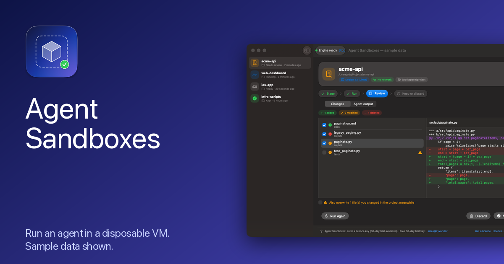
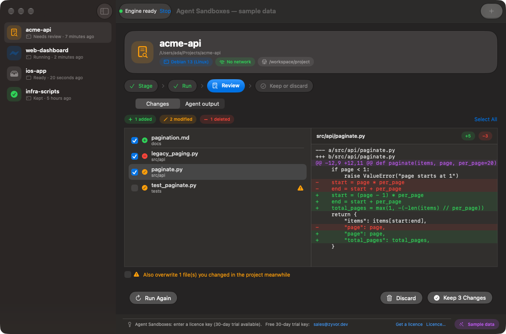
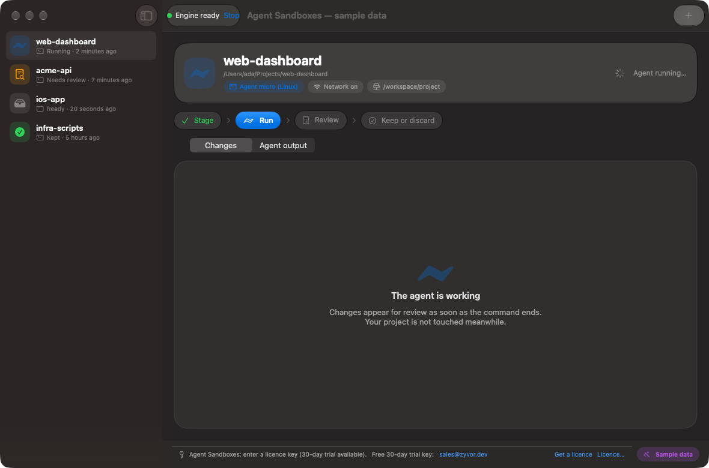
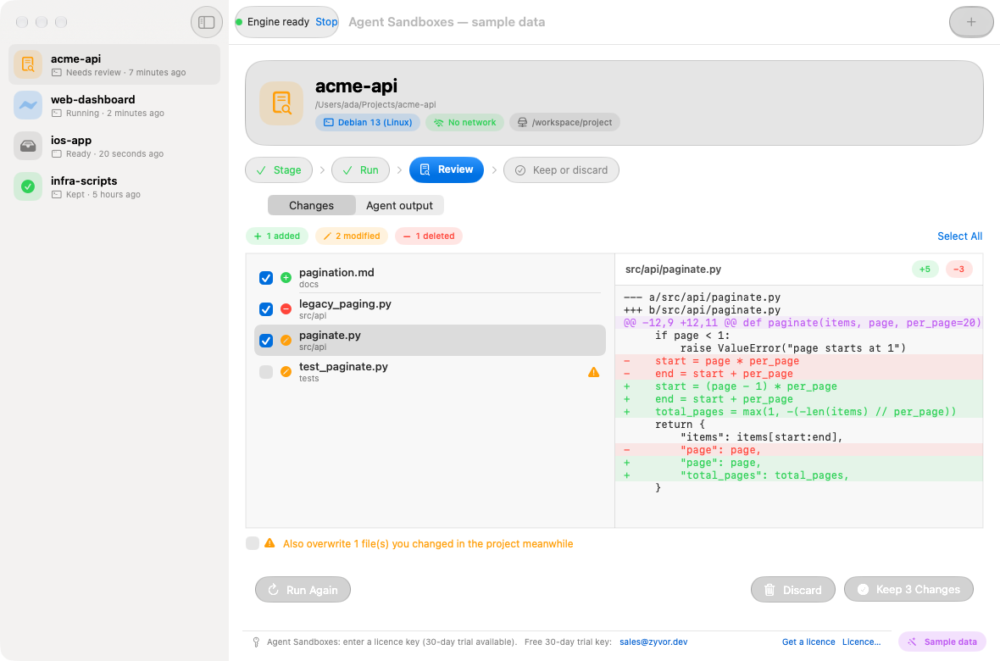
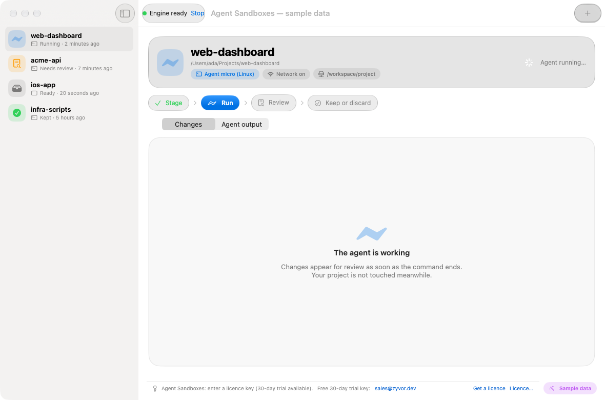

# Agent Sandboxes

### Run an agent in a disposable VM.

A native macOS 27 menu-bar app that runs a coding agent in a throwaway VM, shows exactly what it changed as a diff, and lets you keep or discard the result.

 

**[Download the 30-day trial](https://github.com/zyvorai/agent-sandboxes/releases/tag/v0.1.0)** &nbsp;·&nbsp; [Website](https://zyvorai.github.io/agent-sandboxes/) &nbsp;·&nbsp; [Licence and trial](docs/LICENSING.md)

`Agent-Sandboxes-0.1.0.dmg` · macOS 27 or later · Apple silicon · Developer ID signed and notarized

---

## Download (trial)

| | |
| --- | --- |
| **Get it** | [Agent Sandboxes 0.1.0](https://github.com/zyvorai/agent-sandboxes/releases/tag/v0.1.0): `Agent-Sandboxes-0.1.0.dmg` (SHA-256 in the release notes and in `Agent-Sandboxes-0.1.0.dmg.sha256`) |
| **Free 30-day trial key** | **sales@zyvor.dev** (the app also works without a key) |
| **Requirements** | macOS 27 or later, Apple silicon |
| **Notarized** | Developer ID signed and notarized by Apple |
| **Price** | INR 3,999 per Mac per year incl. 18% GST in India (about US$40 excl. tax outside India). Teams of 5 or more Macs: INR 3,399 per Mac per year (about US$34 excl. tax), minimum 5 Macs (INR 16,995, about US$171), by invoice. Prices: INR incl. 18% GST in India; US dollars excl. tax elsewhere (VAT, GST or sales tax added where applicable). Pay online by UPI, card or netbanking; international cards work (charged in rupees); or request a US-dollar invoice by bank transfer. Custom pricing: contact sales@zyvor.dev. Buy: [zyvor.dev/buy](https://zyvor.dev/buy#agent-sandboxes) (free 30-day trial first). |

Open the DMG and drag AgentSandboxes to Applications. See [docs/INSTALL.md](docs/INSTALL.md).

## See it

*Screenshots are renders of the app's own views with invented sample data, not captures of a live session.*

| Review the diff | A run in progress |
| --- | --- |
|  |  |
|  |  |

## The flow

1. **Pick a template** (Debian 13, Agent micro, or a macOS guest) and a project folder.
2. **Stage.** The project is cloned with APFS copy-on-write; the VM mounts the clone, never your project.
3. **Run.** The agent command runs in the VM. When it ends the VM is deleted.
4. **Review.** Added, modified and deleted files with a unified diff each.
5. **Keep or discard.** Keep writes only the files you ticked. Edits you made to the project meanwhile are flagged as conflicts and skipped unless you overwrite.

The VM engine is FluxVM 0.4.21 (Zyvor Production License v1.0), bundled. Only the `com.apple.security.virtualization` entitlement is used.

## Honest limits

Version 0.1.0 is a first release.

- Verified: a real Linux guest boot through the whole stage, run, review, keep flow.
- **Not verified:** macOS guest project mounting, IPSW install and boot. Apple allows at most **two** macOS guests at once; the app refuses a third.
- No vmnet (bridged/shared) networking and no USB passthrough.
- Apple silicon only.
- The UI was not clicked through on a live desktop before release; screenshots are sample-data renders.

## Trial and licence

- A paid app with a free 30-day trial. **It never disables a feature**: without a key everything works and a status line says so.
- **Free 30-day trial key, or a paid licence: sales@zyvor.dev.** Price: INR 3,999 per Mac per year incl. 18% GST in India (about US$40 excl. tax outside India). Teams of 5 or more Macs: INR 3,399 per Mac per year (about US$34 excl. tax), minimum 5 Macs (INR 16,995, about US$171), by invoice.
- Terms: [Zyvor Production License v1.0](LICENSE). See also [NOTICE](NOTICE) and [docs/LICENSING.md](docs/LICENSING.md).

## Documentation

| Doc | Topic |
| --- | --- |
| [Website](https://zyvorai.github.io/agent-sandboxes/) | The product page |
| [Install](docs/INSTALL.md) · [Licence](docs/LICENSING.md) · [FAQ](docs/FAQ.md) | Guides |
| [Changelog](CHANGELOG.md) · [Security](SECURITY.md) | Release notes, reporting (security@zyvor.dev) |

**The Agent Sandboxes source code is private.** This repository holds the documentation, website and downloads.

Copyright © 2026 Zyvor AI Labs Private Limited · [zyvor.dev](https://zyvor.dev)
